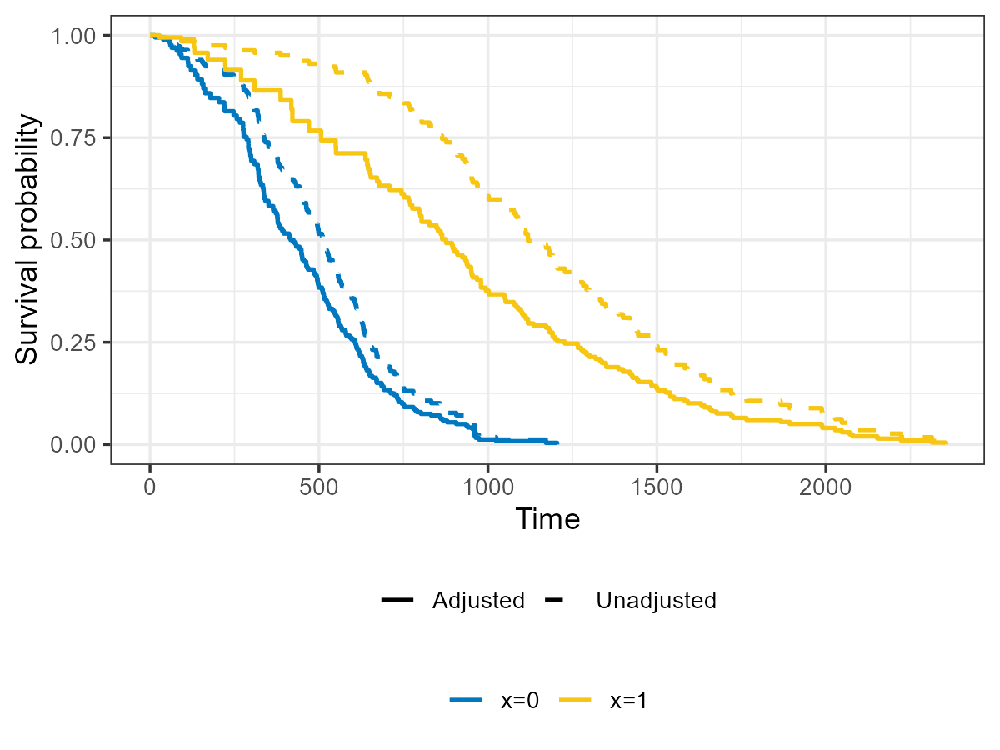
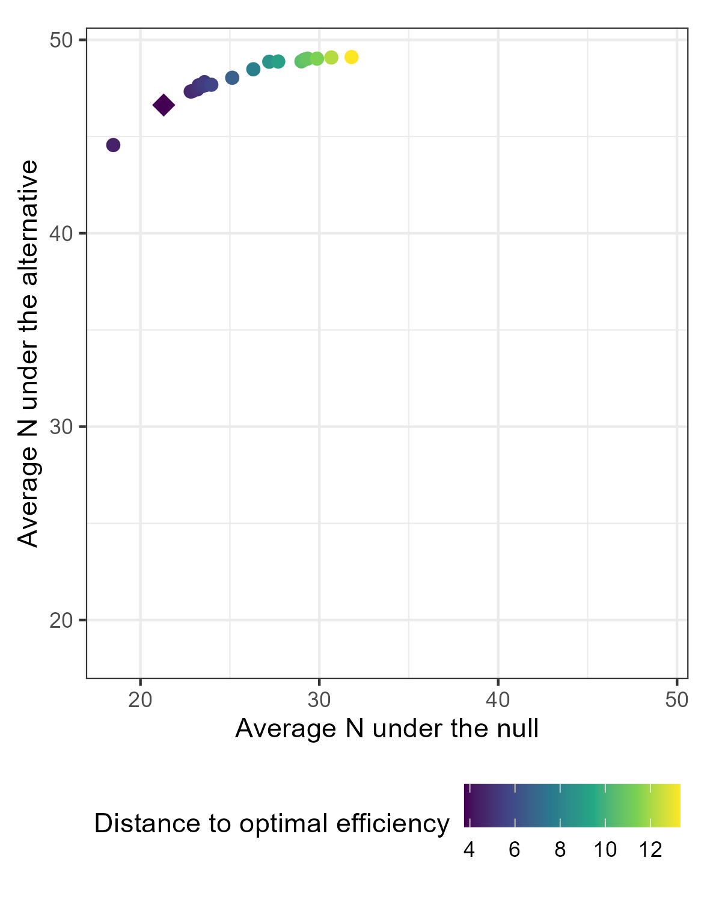
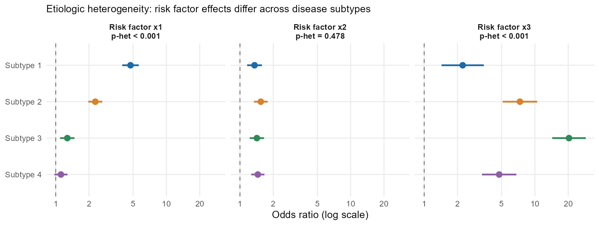
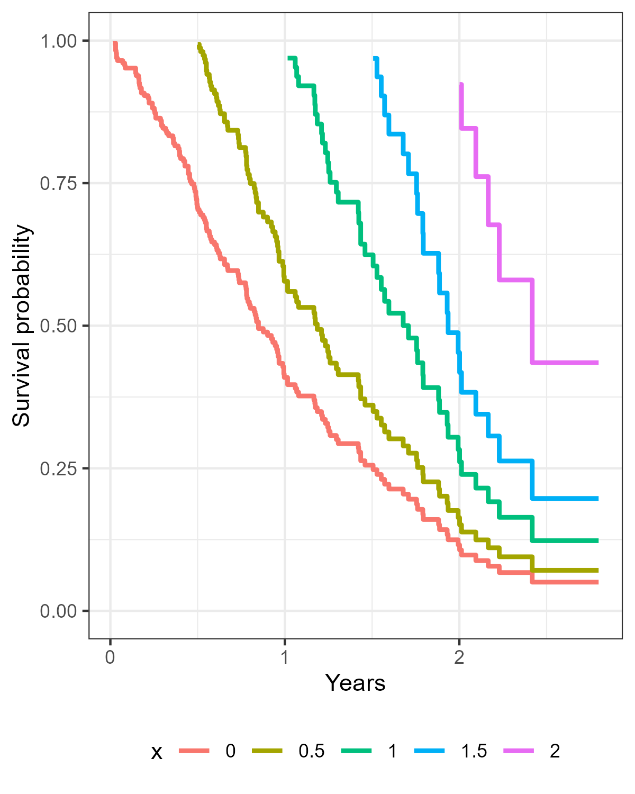

Open-source R packages I develop and maintain. Each package has its own documentation site with function references and worked examples.

::::: {.package-grid .column-page}

::: {.package-card}
## ipcw

[New]{.badge}

Inverse probability of censoring weighted (IPCW) methods for right-censored data, with a single event or competing risks. Corrects Kaplan-Meier, cumulative incidence, Cox, and Fine-Gray analyses for dependent censoring. Companion to Zabor & Eaton (2025).

{.fig-narrow fig-alt="Unadjusted and IPCW-adjusted Kaplan-Meier curves for two groups, showing that ignoring dependent censoring overestimates survival"}

```r
pak::pak("zabore/ipcw")
```

[Documentation](https://www.emilyzabor.com/ipcw/){.btn}
[GitHub](https://github.com/zabore/ipcw){.btn .btn-alt}
:::

::: {.package-card}
## ppseq

Design clinical trials with sequential Bayesian predictive probability monitoring for futility. Supports one-arm and two-arm trials; basket trial functionality is under development.

{.fig-logo fig-alt="ppseq package logo"}

```r
install.packages("ppseq")
```

[Documentation](http://www.emilyzabor.com/ppseq/){.btn}
[GitHub](https://github.com/zabore/ppseq){.btn .btn-alt}
:::

::: {.package-card}
## riskclustr

Functions for the study of etiologic heterogeneity: quantify how much risk factor effects differ across disease subtypes in case-control and case-only studies, and test for heterogeneity across subtypes or individual disease markers.

{.fig-wide fig-alt="Forest plot of subtype-specific odds ratios for three risk factors across four disease subtypes"}

```r
install.packages("riskclustr")
```

[Documentation](https://www.emilyzabor.com/riskclustr/){.btn}
[GitHub](https://github.com/zabore/riskclustr){.btn .btn-alt}
:::

::: {.package-card}
## condsurv

Conditional survival analysis: estimate survival probabilities given that a patient has already survived for some period of time.

{.fig-logo fig-alt="condsurv package logo"}

```r
pak::pak("zabore/condsurv")
```

[Documentation](https://www.emilyzabor.com/condsurv/){.btn}
[GitHub](https://github.com/zabore/condsurv){.btn .btn-alt}
:::

:::::
