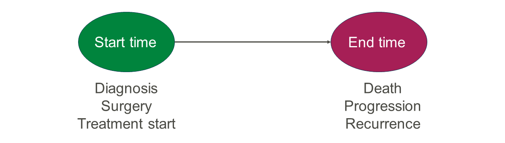
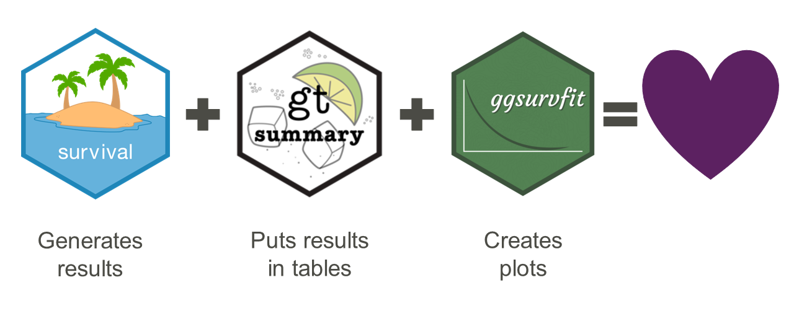
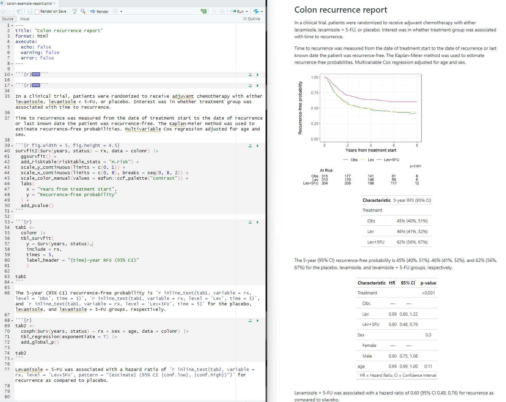

```{r echo = FALSE}
library(ggplot2)
library(tibble)
library(ezfun)
library(dplyr)
library(survival)
library(gtsummary)
library(ggsurvfit)
library(gt)
```


## Time-to-event endpoints are common in biomedical research




## Common research questions relate to times and probabilities

:::: {.columns}

::: {.column width="50%"}
<p align="left"></p>
:::

::: {.column width="50%"}
- What is the probability of remaining event-free for a certain number of years?
- What is the average amount of event-free time?
:::

::::


## Survival analysis methods needed when follow-up time varies

```{r swimmer, echo = FALSE}
# make fake data
set.seed(20180809)
fkdt <- tibble(Subject = as.factor(1:10), 
                   Years = sample(4:20, 10, replace = T),
                   censor = sample(c("Censor", rep("Event", 2)), 10, 
                                   replace = T)) 

# plot with shapes to indicate censoring or event
ggplot(fkdt, aes(Subject, Years)) + 
  geom_bar(stat = "identity", width = 0.5, fill = ccf_cols("ccf_black")) + 
  geom_point(data = fkdt, 
             aes(Subject, Years, color = censor, shape = censor), 
             size = 7) +
  coord_flip() +
  theme_minimal() + 
  theme(legend.title = element_blank(),
        legend.position = "bottom") + 
  scale_color_manual(values = ccf_cols(c("ccf_green", "lightning_yellow")))
```


## The {survival} package is the basis of the survival ecosystem in R {.smaller}

:::: {.columns}

::: {.column width="40%"}
<p align="left"></p>
:::

::: {.column width="60%"}

<br>

- Began development in 1985
- Total of 11.9M downloads
- Active development ongoing
- Many detailed vignettes covering both the basics and advanced topics
- Includes the essential methods
:::

::::

```{r eval = FALSE, echo = TRUE}
install.packages("survival")
library(survival)
```


## Happiness is reproducible publication-ready tables and plots {.smaller}

<p align="center"></p>

```{r eval = FALSE, echo = TRUE}
install.packages(c("gtsummary", "ggsurvfit"))
library(gtsummary)
library(ggsurvfit)
```


## Example dataset

The `colon` data come from a clinical trial of adjuvant therapy for colon cancer, and are included in the {survival} package.

<br>

Variables of interest:

```{r echo = FALSE}
tibble(
  Variable = c("rx", "sex", "years", "status"),
  `Variable description` = c("Treatment assignment", "Sex", "Years to status", 
                             "Censoring status"),
  Levels = c("Obs(ervation), Lev(amisole), Lev(amisole)+5-FU", 
             "1=male, 0=female", "Continuous years", "0=censored, 1=recurrence")
  ) |> 
  gt()
```

<br>

::: {style="font-size: 75%;"}

See appendix slide for code to generate altered example data `colonr`.

:::

```{r echo = FALSE}
# Limit dataset to recurrence events (there are 2 rows per patient - 1 for death and 1 for recurrence)
# Scale time from days to years
colonr <- 
  colon |> 
  filter(etype == 1) |> 
  mutate(
    years = time / 365.25,
    sex = case_match(
      sex,
      0 ~ "Female",
      1 ~ "Male"
    )
  ) |> 
  labelled::set_variable_labels(
    rx = "Treatment", 
    sex = "Sex"
  )
```


## Survival tables with {gtsummary} {.smaller}

Use `tbl_survfit()` to create:

- Tables of median event-free time
- Tables of x-time event-free probability

Use `tbl_uvregression()` to create:

- Tables of univariate Cox regression results

Use `tbl_regression()` to create:

- Tables of multivariable Cox regression results

Tables are highly customizable, see [https://www.danieldsjoberg.com/gtsummary/](https://www.danieldsjoberg.com/gtsummary/) for details and vignettes to get started


## Table of median event-free time

Use `tbl_survfit()` with the `probs = 0.5` argument:

```{r echo = TRUE}
#| output-location: column
list(
  survfit(
    Surv(years, status) ~ 1, 
    data = colonr),
  survfit(
    Surv(years, status) ~ rx, 
    data = colonr)
  ) |> 
  tbl_survfit(
    probs = 0.5,
    label_header = 
      "Median (95% CI)"
    )
```

::: {style="font-size: 75%;"}

- Highly customizable
- Can set labels, titles, subtitles, footnotes, and more

:::


## Table of x-year event-free probability

Use `tbl_survfit()` with the `times = 5` argument:

```{r echo = TRUE}
#| output-location: column
list(
  survfit(
    Surv(years, status) ~ 1, 
    data = colonr),
  survfit(
    Surv(years, status) ~ rx, 
    data = colonr)
  ) |> 
  tbl_survfit(
    times = 5,
    label_header = 
      "{time}-year RFS (95% CI)"
    )
```

::: {style="font-size: 75%;"}

- Note the use of {glue} syntax in the label header to dynamically code the column header

:::


## Inline results reporting {.smaller}

Save the `tbl_survfit()` result to an object (here, `tab1`) so that table statistics can be extracted for use inline with the `inline_text()` function.

<br>

```{r}
tab1 <-
  colonr |> 
  tbl_survfit(
    y = Surv(years, status),
    include = rx,
    probs = 0.5,
    label_header = 
      "Median (95% CI)")
```

The inline code:

> The median (95% CI) recurrence-free time for the Levamisole treatment group is `` `r knitr::inline_expr("inline_text(tab1, variable = rx, level = 'Lev', prob = 0.5)")` ``.

<br>

Will show as:

> The median (95% CI) recurrence-free time for the Levamisole treatment group is `r inline_text(tab1, variable = rx, level = 'Lev', prob = 0.5)`.


## Univariate Cox regression table

Use `tbl_uvregression()`:

```{r echo = TRUE}
#| output-location: column
colonr |> 
  tbl_uvregression(
    method = coxph,
    y = Surv(years, status),
    include = c(rx, sex),
    exponentiate = T
    ) |> 
  add_global_p()
```

::: {style="font-size: 75%;"}

- Fits models for all variables listed in `include =`
- `exponentiate = T` to obtain hazard ratios
- Add global p-values

:::


## Multivariable Cox regression table

Pass fitted model results directly to `tbl_regression()`:

```{r echo = TRUE}
#| output-location: column
coxph(
  Surv(years, status) ~ 
    rx + sex, 
  data = colonr
  ) |> 
  tbl_regression(
    exponentiate = T
  ) |> 
  add_global_p()
```


## Time-to-event plots with {ggsurvfit} {.smaller}

Uses {ggplot2} as the basis so known customizations are available with the `+` operator.

- Plot Kaplan-Meier curves using `ggsurvfit`
- Plot cumulative incidence curves for competing risks using `ggcuminc`
- Plot multi-state models using `ggsurvfit`

Options to:

- Add confidence intervals
- Add risk tables
- Add quantiles
- And more

See [https://www.danieldsjoberg.com/ggsurvfit/](https://www.danieldsjoberg.com/ggsurvfit/) for details and vignettes to get started


## Kaplan-Meier curves with ggsurvfit()

```{r echo = TRUE, warning = FALSE, fig.height = 5, fig.width = 4.5}
#| output-location: column
survfit2(
  Surv(years, status) ~ 1, 
  data = colonr
  ) |>
  ggsurvfit() + 
  add_confidence_interval() + 
  add_risktable() +
  scale_y_continuous(
    limits = c(0, 1)
    ) + 
  scale_x_continuous(
    limits = c(0, 8), 
    breaks = seq(0, 8, 2)
  ) +
  labs(
    x = "Years from treatment start",
    y = "Recurrence-free probability"
  )
```


## Put it all together {.scrollable}

<!--  -->
<p align="center"></p>


## Thank you, and please get in touch

<br>

 [zabore2@ccf.org](zabore2@ccf.org)

 [https://www.emilyzabor.com/](https://www.emilyzabor.com/)

 [https://github.com/zabore](https://github.com/zabore)

 [https://www.linkedin.com/in/emily-zabor-59b902b7/](https://www.linkedin.com/in/emily-zabor-59b902b7/)


## Appendix: Create example dataset {.smaller}

- `colon` dataset from {survival} altered to:

    - Limit to one row per patient with interest in recurrence rather than death
    - Scale time from days to years
    - Recode sex levels to informative values
    - Label variables of interest

```{r echo = TRUE}
colonr <- 
  colon |> 
  filter(etype == 1) |> 
  mutate(
    years = time / 365.25,
    sex = case_match(
      sex,
      0 ~ "Female",
      1 ~ "Male"
    )
  ) |> 
  labelled::set_variable_labels(
    rx = "Treatment", 
    sex = "Sex"
  )
```


